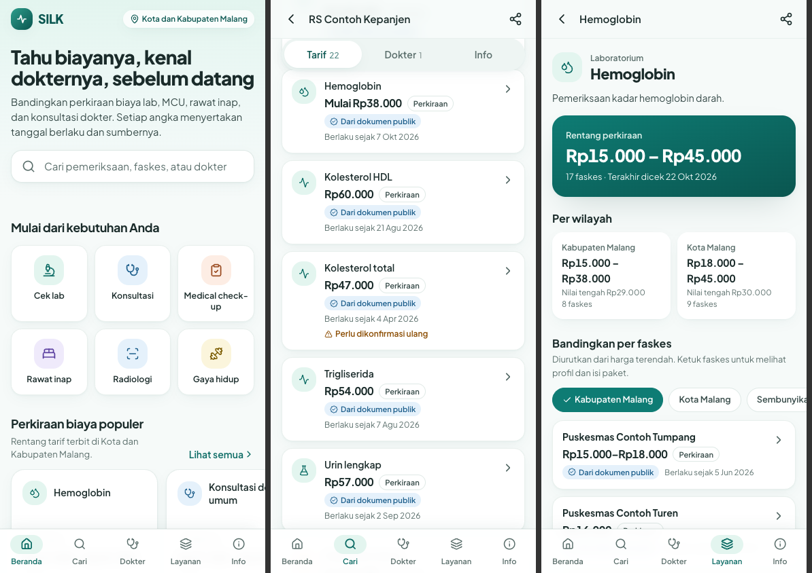
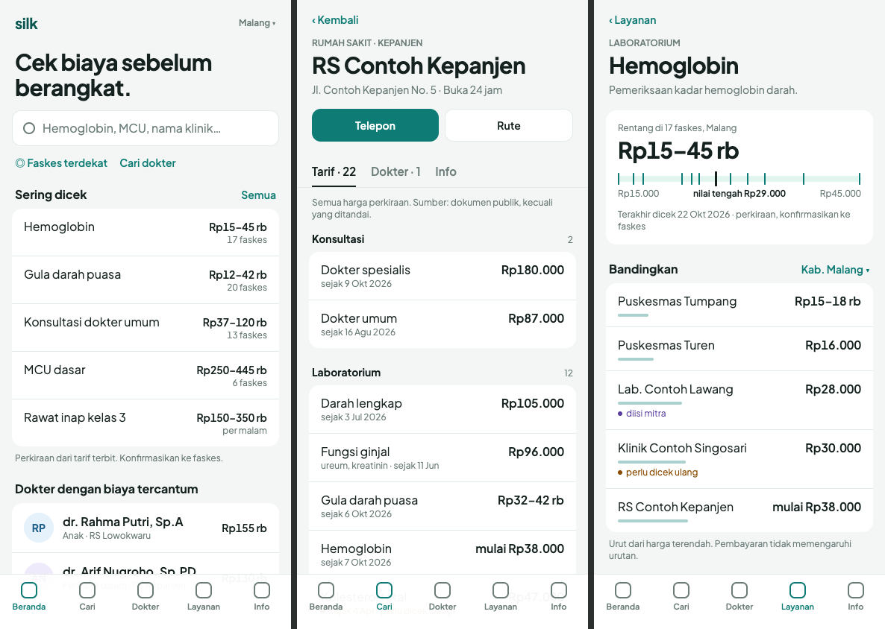

# Evaluasi UI/UX SILK Mobile: terasa "AI" dan kaku (13 November 2026)

## Ringkasan

Keluhan pemilik: tampilan terkadang **terlalu "AI"** dan **kaku**. Evaluasi membenarkan keduanya, dan penyebabnya bisa diukur.

- **Terasa AI** karena SILK memakai pola template generik, bukan pola aplikasi harga:
  - kotak ikon pastel di setiap baris (32 di `/layanan`; satu ikon yang sama dipakai untuk 4 pemeriksaan kolesterol);
  - label yang sama diulang di setiap harga ("Perkiraan" muncul 68 kali di satu halaman hasil);
  - beranda berbentuk landing page (judul besar, grid ikon 3×2, "cara kerja" 3 kartu, banner gradien);
  - kartu gradien hijau tua sebagai "hero";
  - kalimat penjelas di bawah setiap judul.
- **Terasa kaku** karena semua isi dibentuk sama:
  - setiap butir adalah kartu putih bersudut 16 px dengan bayangan dan chevron (40 kartu `shadow-soft` di kode);
  - kartu di dalam kartu;
  - 23 ukuran huruf berbeda, tujuh di antaranya hanya berselisih 0,3–0,6 px, sehingga hierarki tidak terbaca;
  - hampir semua teks semibold;
  - harga, isi terpenting aplikasi ini, tidak diberi posisi khusus.

**Arah perbaikan:** SILK dirancang seperti **papan tarif**, bukan dashboard SaaS.
- Daftar berkelompok dengan harga rata kanan.
- Keterangan cukup disebut sekali, lalu hanya pengecualian yang ditandai di tiap baris.
- Lima ukuran huruf saja.
- Ikon hanya untuk aksi dan navigasi.
- Data ditampilkan sebagai visual, misalnya batang rentang harga.

Konsep tiga layar di bawah menunjukkan arah ini. Di profil RS, harga yang terlihat dalam satu layar naik dari ±3 menjadi ±6.

*Sekarang: beranda, daftar tarif RS, detail layanan.*

*Konsep: layar dan data yang sama.*

## 1. Metode

- **Cakupan:** 8 layar SILK Mobile di 390 × 844 px dengan data demo lokal (API live). Tangkapan per layar sepanjang halaman.
- **Pengukuran DOM** di `<main>`: kartu (berbayang, sudut ≥ 12 px, tinggi > 40 px), pil, kotak ikon, gradien, ukuran dan bobot huruf, gambar.
- **Pengukuran kode** di `MOBILE/src`: kelas ukuran teks, sudut, dan bayangan.
- Web (`apps/web`) memakai token dan pola yang sama, jadi sebagian besar temuan juga berlaku di sana. Web dievaluasi terpisah bila diminta.

| Layar | Tinggi (px) | Kartu | Pil | Kotak ikon | Gambar | Ukuran huruf | Teks bobot 600 |
| --- | --- | --- | --- | --- | --- | --- | --- |
| Beranda | 1.863 | 21 | 18 | 17 | 0 | 13 | 36 |
| Cari `?service=hemoglobin` | 4.058 | 18 | **68** | 0 | 0 | 9 | 75 |
| Profil RS Kepanjen | 3.556 | 25 | 59 | 22 | 0 | 9 | **82** |
| Daftar dokter | 2.205 | 8 | 30 | 0 | 0 | 9 | 31 |
| Profil dokter | 1.847 | 10 | 14 | 3 | 0 | 10 | 21 |
| Katalog layanan | 3.479 | 33 | 8 | **32** | 0 | 7 | 40 |
| Detail Hemoglobin | 1.815 | 12 | 22 | 1 | 0 | 10 | 28 |

Di kode, ukuran teks yang dipakai:
- 23 ukuran berbeda, 15 di antaranya nilai bebas (`text-[0.72rem]`, `[0.75rem]`, `[0.78rem]`, `[0.8rem]`, `[0.82rem]`, …);
- `shadow-soft` 40 kali, `font-semibold` 60 kali, `bg-gradient` 6 kali.

## 2. Mengapa terasa "AI"

**A1. Kotak ikon pastel di setiap baris.**
- Katalog layanan punya 32 kotak ikon dan profil RS 22.
- Ikonnya hampir tidak memberi informasi: Kolesterol HDL, LDL, total, dan trigliserida memakai ikon yang sama (garis detak jantung).
- Pola "ikon di kotak warna lembut + judul + teks abu" adalah ciri paling mudah dikenali dari UI buatan generator.
- Kategori sudah jelas dari pengelompokan, jadi ikon tidak diperlukan.

**A2. Label yang sama di setiap harga.**
- Setiap harga membawa pil "Perkiraan" dan lencana sumber, misalnya "Dari dokumen publik".
- Di hasil Hemoglobin ada 68 pil. Di profil RS, 20 dari 22 tarif memakai sumber yang sama.
- Pengulangan seragam terbaca sebagai hasil mesin. Keterangan yang penting, yaitu tarif lama atau diisi mitra, justru tenggelam.

**A3. Beranda adalah landing page, bukan aplikasi.** Urutannya: judul pemasaran dan paragraf, grid 3×2 ikon, karusel kartu, "Cara membaca angka di SILK" (3 kartu ikon), lalu banner gradien "Urutan yang netral". Ini kerangka landing page SaaS. Aplikasi kesehatan yang dipakai sehari-hari (peta, apotek daring, telemedis) membuka langsung dengan alat: kotak cari, pintasan, dan isi.

**A4. Gradien dekoratif.** Ada enam: latar header beranda, logo, kartu "Rentang perkiraan", banner netral, dan Info. Kartu hijau tua bergradien dengan bayangan besar adalah ciri template lain. Gradien juga melawan sifat SILK yang netral dan faktual.

**A5. Teks menjelaskan berlebihan.**
- Hampir setiap judul layar diikuti kalimat abu-abu.
- Pernyataan "urutan tidak dipengaruhi pembayaran" muncul di 4 layar.
- Judul seperti "Mulai dari kebutuhan Anda" dan "Cara membaca angka di SILK" bernada brosur.

**A6. Tumpukan lencana di header.** Profil faskes membuka dengan tiga pil (jenis, wilayah, sumber) sebelum nama. Mata membaca pil dulu, baru nama.

## 3. Mengapa terasa kaku

**B1. Satu bentuk untuk semua isi.**
- Setiap tarif, layanan, faskes, jadwal, dan langkah metodologi adalah kartu putih yang sama, bersudut 16 px, dengan bayangan dan chevron.
- Tidak ada baris daftar, pemisah tipis, atau kelompok.
- Akibatnya kepadatan rendah: satu tarif di profil RS setinggi ±134 px, jadi hanya ±3 harga per layar, dan 22 tarif menjadi 3.556 px.

**B2. Kartu di dalam kartu.** Kartu dokter dan kartu hasil cari memuat kotak abu berisi harga di dalam kartu putih. Batas bertumpuk membuat tampilan berat.

**B3. Skala huruf acak, bobot seragam.**
- Satu halaman memakai 9–13 ukuran. Tujuh di antaranya ada di rentang 10,9–13,1 px dan bedanya tidak terlihat.
- Bobot 600 mendominasi (82 kali di profil RS).
- Semua terasa sama keras, sehingga tidak ada yang menonjol.

**B4. Ritme seragam.**
- Setiap bagian berpola sama: judul tebal, kalimat abu, "Lihat semua ›", deret kartu.
- Jarak tepi (16 px) dan celah (10 px) selalu sama.
- Menggulir terasa seperti melewati blok yang diulang.

**B5. Harga tidak diberi posisi khusus.**
- Di aplikasi transparansi tarif, harga adalah tokoh utama. Sekarang harga rata kiri di bawah nama, bobotnya hampir sama dengan nama, lalu diikuti pil.
- Membandingkan harga butuh mata bergerak zig-zag.
- Kolom harga yang rata kanan dengan angka tabular memungkinkan membandingkan sambil menggulir.

**B6. Data jadi hiasan, bukan visual.**
- Rentang harga ditulis dalam kartu gradien.
- Kotak "Per wilayah" mematahkan rentang jadi dua baris ("Rp15.000 –" / "Rp38.000").
- Daftar banding tidak memperlihatkan posisi relatif tiap faskes.
- Datanya (min, median, harga tiap faskes) sudah ada dan cukup untuk visual sederhana yang informatif.

## 4. Temuan kecil

| # | Temuan | Lokasi |
| --- | --- | --- |
| C1 | Celah kosong ±52 px antara kotak cari dan "Mulai dari kebutuhan Anda" saat banner demo tidak tampil | `app/page.tsx` (header `pb-6` + `Section` `mt-7`) |
| C2 | "Medical check-up" patah menjadi "check-" / "up" | grid pintasan beranda |
| C3 | Rentang harga per wilayah patah dua baris | `layanan/[slug]` |
| C4 | Format rentang tidak konsisten: "Rp15.000–Rp18.000" vs "Rp15.000 – Rp45.000" | `PriceTag` vs `priceRangeText` |
| C5 | "Terhubung ke server SILK" adalah bahasa teknis untuk pasien | `info/page.tsx` |

## 5. Arah desain

1. **Papan tarif, bukan dashboard.**
   - Daftar berkelompok: satu permukaan putih per kelompok, dengan baris yang dipisah garis tipis.
   - Nama di kiri, harga di kanan dengan angka tabular.
   - Kartu dipakai hanya untuk benda yang berdiri sendiri, misalnya ringkasan rentang.
2. **Katakan sekali, tandai pengecualian.**
   - "Semua harga perkiraan" dan sumber yang paling umum disebut di kepala kelompok.
   - Di baris hanya muncul yang berbeda: tarif lama, diisi mitra, belum diverifikasi. Tandanya titik warna dan teks pendek.
   - Tanggal berlaku tetap tampil di setiap baris. Rincian lengkap tetap ada di sheet detail tarif.
3. **Lima ukuran huruf:** 12 / 14 / 16 / 20 / 30 px.
   - Bobot 400 untuk isi, 600 untuk nama dan harga, 700 hanya untuk judul layar.
   - Semua nilai bebas `text-[…rem]` diganti token.
4. **Ikon hanya untuk aksi dan navigasi** (telepon, rute, bagikan, menu bawah). Ikon dekoratif di daftar dihapus. Kategori dibaca dari kepala kelompok.
5. **Datar dan tenang.**
   - Tanpa gradien.
   - Bayangan hanya untuk elemen melayang: menu bawah, sheet, tombol mengambang.
   - Dua sudut saja: 12–14 px untuk kelompok dan tombol, penuh untuk chip filter.
6. **Beranda adalah alat.** Urutannya:
   - judul pendek;
   - kotak cari;
   - pintasan teks ("Faskes terdekat", "Cari dokter");
   - daftar "Sering dicek" dengan rentang harga;
   - dokter dengan biaya tercantum.

   "Cara membaca angka" dan "Urutan netral" pindah ke Info. Di beranda cukup satu baris catatan kaki.
7. **Data sebagai visual.**
   - Batang rentang dengan tanda tiap faskes dan nilai tengah di detail layanan.
   - Garis relatif pendek di setiap baris banding.
8. **Teks lebih pendek.**
   - Hapus kalimat penjelas di bawah judul daftar.
   - Pernyataan urutan netral cukup satu kali, di tempat urutan terjadi: daftar banding dan hasil cari.
   - Judul berupa kata benda atau kata kerja ("Sering dicek", "Bandingkan").

Yang **tidak** berubah:
- token warna dan font;
- aturan M17;
- urutan netral;
- tanggal berlaku di setiap harga;
- label perkiraan (pindah ke tingkat kelompok, tetap terlihat di layar yang sama);
- banner mode demo;
- semua alur dan URL.

## 6. Rencana perbaikan

| Prioritas | Perubahan | Berkas utama |
| --- | --- | --- |
| P0 | Token skala huruf (5 ukuran) di `@theme`; ganti semua `text-[…rem]`; kurangi `font-semibold` | `globals.css`, semua komponen |
| P0 | Komponen `ListGroup` / `ListRow` (daftar berkelompok, harga rata kanan) | `components/list.tsx` (baru) |
| P0 | Daftar tarif faskes/dokter, katalog layanan, daftar banding, dan "Sering dicek" memakai `ListGroup`; label perkiraan dan sumber di kepala kelompok, pengecualian per baris | `tariff-browser.tsx`, `service-catalog.tsx`, `layanan/[slug]/page.tsx`, `app/page.tsx`, `price.tsx`, `trust.tsx` |
| P0 | Beranda versi alat (lihat §5.6); "Cara membaca" dan banner netral pindah ke Info | `app/page.tsx`, `info/page.tsx`, `messages/id.ts` |
| P1 | Hapus kotak ikon di daftar dan semua gradien; bayangan hanya untuk elemen melayang | `service-icon.tsx`, halaman terkait |
| P1 | Header faskes dan dokter: baris keterangan teks (eyebrow) menggantikan pil | `faskes/[slug]`, `dokter/[slug]` |
| P1 | Batang rentang dan garis relatif di detail layanan; per wilayah jadi baris, bukan kotak | `layanan/[slug]`, `lib/range.ts` (baru, diuji) |
| P1 | Kartu hasil cari dan kartu dokter tanpa kotak dalam; harga rata kanan | `facility-card.tsx`, `doctor-card.tsx` |
| P2 | Pangkas teks penjelas; pernyataan netral satu kali per alur | `messages/id.ts` (uji M17 tetap) |
| P2 | Temuan kecil C1–C5 | lihat §4 |

Uji yang ditambah:
- posisi tanda pada batang rentang;
- format rentang yang konsisten (C4);
- aturan "hanya pengecualian yang ditandai";
- uji M17 dan uji yang ada tetap lolos.

Verifikasi: tangkapan ulang 8 layar dan ukur lagi tabel §1. Target:
- ≤ 6 ukuran huruf per halaman;
- 0 kotak ikon di daftar;
- pil di hasil cari turun di bawah 15;
- tinggi profil RS turun ±40%.

## 7. Keputusan yang perlu disetujui

1. **Label perkiraan dan sumber per kelompok, bukan per baris.**
   - USP meminta angka biaya "diberi keterangan sebagai perkiraan" (`docs/usp-silk.md`). Usulan ini tetap memenuhinya: keterangan selalu terlihat di kepala kelompok pada layar yang sama, dan sheet detail tetap memuat sumber dan tingkat verifikasi lengkap.
   - Bila pemilik ingin keterangan tetap di setiap baris, cukup dibuat lebih ringan: teks kecil "perkiraan", bukan pil.
2. **Format ringkas "Rp15–45 rb"** hanya di daftar ringkasan (beranda, katalog). Di profil faskes dan daftar banding, harga tetap ditulis penuh.

## 8. Status penerapan (13 November 2026)

Diterapkan atas permintaan pemilik ("detail dokter lebih baik, dan layout lain"). Keputusan §7 memakai rekomendasi:
label perkiraan dan sumber per kelompok, format ringkas hanya di daftar ringkasan.

**Detail dokter dan kartu dokter**
- Header: nama, spesialisasi, lalu kredensial sebagai teks (STR, mitra, wilayah), bukan pil.
- Strip fakta 3 kolom: biaya konsultasi, jadwal terdekat ("Hari ini", "Besok", "Sekarang, sampai 20.00"), jumlah tempat praktik.
- "Jadwal" dan "Tempat praktik" digabung per lokasi; baris hari ini disorot; strip pekan S S R K J S M.
- Kartu dokter di tab Dokter profil faskes: strip pekan + jadwal terdekat di faskes itu; di atasnya biaya konsultasi faskes.
- "Hari ini" dihitung di peramban (zona Asia/Jakarta) agar benar walau halaman di-cache.

**Layout lain**
- Komponen `ListGroup`/`ListRow`: daftar tarif, katalog, banding, hasil cari, daftar dokter, beranda, Info.
- Harga rata kanan; "Perkiraan" dan sumber terbanyak sekali di kepala daftar; baris hanya menandai yang berbeda.
- Beranda versi alat; "Cara membaca angka" pindah ke Info. Tab bergaris bawah; chip aktif berwarna tinta.
- Detail layanan: batang sebaran harga per wilayah (nilai tengah ditebalkan) dan garis relatif per faskes.
- Jam buka yang sama digabung ("Setiap hari 24 jam", "Senin–Jumat").
- Kotak ikon, gradien, dan `section.tsx`/`service-icon.tsx` dihapus; semua ukuran huruf bebas diganti skala Tailwind.
- Temuan kecil C1–C4 selesai (C5, bahasa teknis di Info, belum).

| Layar | Tinggi sebelum → sesudah (px) | Ukuran huruf | Kotak ikon | Pil |
| --- | --- | --- | --- | --- |
| Beranda | 1.863 → 1.575 | 13 → 5 | 17 → 0 | 18 → 10 |
| Cari `?service=hemoglobin` | 4.058 → 2.348 | 9 → 4 | 0 → 0 | 68 → 17 |
| Profil RS Kepanjen | 3.556 → 2.441 | 9 → 4 | 22 → 0 | 59 → 9 |
| Daftar dokter | 2.205 → 1.255 | 9 → 4 | 0 → 0 | 30 → 17 |
| Katalog layanan | 3.479 → 2.724 | 7 → 4 | 32 → 0 | 8 → 8 |

Gradien di semua layar: 0. Uji: 350 lolos (termasuk jadwal terdekat, gabung jam buka, penanda kepercayaan, format rentang).
